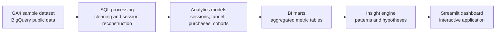

# GrowthScope

**Marketing & Growth Intelligence for E-commerce**


> **GrowthScope turns raw GA4 event data from an e-commerce store into decisions**: where customers drop off, which acquisition channels bring valuable visitors, where revenue leaks — and which fixes are worth testing first.

> 🚧 **Status: Sprint 01 — Data Discovery (early development).** The repository currently contains the project foundation (README, license, gitignore). Data exploration is in progress; SQL models, dashboard and tests are on the [roadmap](#roadmap) below.

## Contents

- [The business problem](#the-business-problem)
- [What GrowthScope delivers](#what-growthscope-delivers)
- [Conversion funnel: the analytical core](#conversion-funnel-the-analytical-core)
- [Growth Opportunity Engine](#growth-opportunity-engine)
- [Architecture](#architecture)
- [Data source](#data-source)
- [Metrics](#metrics)
- [Tech stack](#tech-stack)
- [Repository structure](#repository-structure)
- [Getting started](#getting-started)
- [Data quality and testing](#data-quality-and-testing)
- [Roadmap](#roadmap)
- [Documentation](#documentation)
- [Limitations and honest analytics](#limitations-and-honest-analytics)
- [License](#license)

## The business problem

An online store gets thousands of visitors, yet the business cannot answer basic growth questions from raw analytics exports:

- Why do most visitors never buy — and at which exact step do they leave?
- Which acquisition channels bring users who actually convert, not just traffic?
- How much potential revenue is lost at each funnel step, and where is the biggest addressable drop-off?
- Which customer segments come back — and which never return?

Answering these questions requires event-level data processing: reconstructing sessions, ordering funnel steps in time, and modeling metrics with transparent, testable formulas. That is what GrowthScope does.

## What GrowthScope delivers

Seven product modules (target: v1.0):

| # | Module | What it answers |
|---|--------|-----------------|
| 01 | **Executive Overview** | Revenue, orders, users, sessions, purchase conversion, AOV, daily dynamics. Filters by period, device, segment |
| 02 | **Conversion Funnel** | How many sessions reach each purchase step, where the largest drop-off happens, differences by device and channel |
| 03 | **Acquisition Intelligence** | Where users come from: audience size, conversion and revenue by source (within GA4 attribution limits) |
| 04 | **Customer Behavior & Retention** | New vs returning users, repeat purchases, cohorts, time from first visit to purchase |
| 05 | **Revenue & Product Analytics** | Top products and categories, revenue, AOV, basket size, products viewed often but rarely bought |
| 06 | **Growth Opportunity Engine** | Data-derived hypotheses: problem segments, scenario-based revenue potential, what to verify next |
| 07 | **Data Quality Monitor** | Missing values, incomplete sessions, suspicious duplicates, event coverage, test status |

## Conversion funnel: the analytical core

The e-commerce funnel:

```text
session → view_item → add_to_cart → begin_checkout → purchase
```

Two levels of rigor, built in sequence:

1. **Event-presence funnel** — the share of sessions where each step occurred at least once.
2. **Ordered funnel** — a step counts only if it happened *after* the previous step within the same session (window functions over event timestamps).

Engineering challenges handled in SQL:

- **Session reconstruction** — `ga_session_id` is unique only within a user, so the session key is `(user_pseudo_id, ga_session_id)`.
- **Repeated events** — multiple `view_item` / `add_to_cart` count once per session, with order preserved.
- **Incomplete sessions** — sessions with missing identifiers are excluded from funnel math *and their share is measured*, not hidden.
- **Segment comparison** — drop-off by device, channel, product category, new vs returning users, time.

The funnel feeds a **revenue opportunity simulator**: e.g. 10,000 sessions, $40 AOV, purchase conversion 2.0% → 2.5% implies +50 orders and +$2,000 expected revenue at constant traffic and AOV. This is a mathematical scenario, **not a causal forecast** — always labeled as such in the product.

## Growth Opportunity Engine

Not a generic "advice generator" — every hypothesis is computed from data and structured for verification:

| Part | Example (illustrative) |
|---|---|
| **Observation** | Mobile step conversion `view_item → add_to_cart` is below desktop |
| **Evidence** | Measured gap in percentage points, affected sessions, estimated revenue at stake |
| **Possible causes** | UX friction on mobile product page, delivery options, audience/product mix |
| **What to check** | Mobile product page audit; A/B test against a measured baseline |
| **Potential effect** | Scenario range, clearly marked as an estimate to validate, not a promise |

## Architecture



Layered data models (dbt management comes post-MVP):

| Layer | Model | Grain / contents |
|---|---|---|
| Staging | `stg_ga4_events` | One row per event; nested GA4 params flattened to typed columns |
| Intermediate | `int_sessions` | One row per session `(user_pseudo_id, ga_session_id)` |
| Intermediate | `int_session_funnel` | Funnel flags and step ordering per session |
| Fact | `fct_purchases` | One row per transaction |
| Mart | `mart_daily_kpis` | Daily revenue, users, sessions, conversion, AOV |
| Mart | `mart_acquisition` | Metrics by traffic source |
| Mart | `mart_products` | Product and category performance |
| Mart | `mart_cohorts` | Cohorts, retention, repeat purchases |

## Data source

**GA4 obfuscated sample e-commerce dataset** (Google Merchandise Store) — public BigQuery dataset `bigquery-public-data.ga4_obfuscated_sample_ecommerce`.

| | |
|---|---|
| Period | November 2020 – January 2021 |
| Format | GA4 event export, nested BigQuery schema |
| Access | BigQuery Sandbox — free, no credit card required |

Google warns that the dataset is obfuscated and partially adjusted. GrowthScope treats this as part of the job: **data audit first, metrics second.**

Honest constraints:

- No advertising-spend table exists in the dataset → **CAC, ROAS and ad profit are out of scope**; nothing is fabricated to fill the gap.
- `traffic_source` fields describe **first-user acquisition**, not per-session attribution — the two are never mixed.
- Raw user events are never committed to this repository; only small aggregated demo data (Parquet) is published.

## Metrics

Core metrics (full formulas, units, aggregation levels and caveats — in `docs/metric_dictionary.md`, planned):

| Metric | Definition | Level |
|---|---|---|
| Sessions | Unique `(user_pseudo_id, ga_session_id)` | Session |
| Users | Unique `user_pseudo_id` | User |
| Purchase Conversion Rate | Sessions with purchase / all sessions | Session (user-level CVR computed separately — they differ) |
| Step Conversion Rate | Sessions reaching step N+1 / sessions reaching step N | Session |
| Drop-off Rate | 1 − step conversion rate | Session |
| Revenue | Sum of purchase revenue (observed currency) | Order |
| Average Order Value | Revenue / number of orders | User, session |
| Revenue per Session | Revenue / number of sessions | Session |
| Repeat Purchase Rate | Buyers with more than one purchase / all buyers | User |
| Time to Purchase | Purchase timestamp − chosen start point | User, session |

## Tech stack

| Technology | Purpose | Priority |
|---|---|---|
| Python | Data processing, analytics logic | Core |
| SQL / BigQuery | Event queries, aggregations, window functions | Core |
| Pandas | Exploratory analysis | Core |
| Streamlit | Web application | Core |
| Plotly | Interactive charts | Core |
| Git / GitHub | Version control, portfolio | Core |
| pytest | Automated testing | Core |
| dbt | SQL model and test management | Post-MVP |
| GitHub Actions | CI and automated checks | Post-MVP |
| PySpark | Large-volume experiments | Advanced track |

## Repository structure

Target structure for v1.0. Today the repository contains the foundation only.

```text
growthscope/
├── app/                     # Streamlit application (pages, components)
├── sql/                     # BigQuery SQL: exploration, staging, sessions, marts
├── dbt/                     # dbt models and tests (post-MVP)
├── src/                     # Python: data_processing, analytics, insights, quality
├── data/
│   └── aggregated/          # small aggregated demo data (Parquet); no raw events
├── notebooks/               # exploratory analysis
├── tests/                   # pytest suite
├── docs/                    # architecture, metric dictionary, limitations, case study
├── .github/workflows/       # CI
├── requirements.txt
├── README.md
└── LICENSE
```

## Getting started

**Prerequisites:** Python 3.11+; for live BigQuery queries — a Google Cloud project with BigQuery Sandbox enabled (free tier).

```bash
git clone https://github.com/nnurkass/growthscope.git
cd growthscope
python -m venv .venv

# Windows PowerShell
.venv\Scripts\activate
# macOS / Linux
source .venv/bin/activate

pip install -r requirements.txt
```

BigQuery authentication (once the data layer lands):

```bash
gcloud auth application-default login
```

Credentials are never committed — the repo is `.env`-friendly with an example file.

Run the dashboard (target state, after Sprint 05):

```bash
streamlit run app/main.py
```

> 🚧 `requirements.txt` and `app/` arrive in later sprints — see the [roadmap](#roadmap).

## Data quality and testing

Automated checks (pytest, SQL tests, CI — from Sprints 03–07):

| Check | Catches |
|---|---|
| `not_null` on key fields | Missing identifiers |
| `unique` on aggregate keys | Duplicated rows |
| Duplicate transaction control | Double-counted revenue |
| Revenue reconciliation (events vs marts) | Metric drift between layers |
| Funnel integrity | Order violations inside sessions |
| Date coverage | Missing dates, missing export tables |
| Missing-data report | Share of unknown device / traffic source |

## Roadmap

| Phase | Focus | Outcome |
|---|---|---|
| 01 Foundation & Discovery | Repo, environment, BigQuery connection, dataset audit | Exploratory notebook, first SQL queries, data quality profile |
| 02 Cleaning & Sessions | Parameter extraction, normalization, session rules | `stg_ga4_events`, `int_sessions` |
| 03 Funnel Analytics | Presence funnel → ordered funnel, drop-off analysis | Verified funnel metrics + SQL tests |
| 04 Metrics & Marts | Revenue, products, acquisition, daily KPIs, metric dictionary | Dashboard-ready marts |
| 05 Streamlit Dashboard | Overview, Funnel, Acquisition with filters | First app version |
| 06 Advanced Analytics | Cohorts, segmentation, Growth Opportunity Engine | At least 3 evidence-based business hypotheses |
| 07 Testing, CI & Deployment | pytest suites, GitHub Actions, public demo | Reproducible project with CI and public link |
| 08 Portfolio Release | Query optimization, demo video, docs, case study | GrowthScope v1.0 |

**v1.0 release checklist**

- [ ] Data can be obtained via documented instructions
- [ ] Core KPIs and the ordered funnel are computed
- [ ] No known double-counting of sessions or revenue
- [ ] At least four working analytical screens
- [ ] Automated tests written
- [ ] Dashboard publicly deployed
- [ ] README, architecture and data limitations documented
- [ ] At least three verifiable business insights

## Documentation

| Document | Contents | Status |
|---|---|---|
| `docs/architecture.md` | Data layers, models, flows | Planned |
| `docs/metric_dictionary.md` | Metric formulas, units, levels, caveats | Planned |
| `docs/data_limitations.md` | Dataset constraints, honestly documented | Planned |
| `docs/business_case_study.md` | Business findings and recommendations | Planned |

## Limitations and honest analytics

- The dataset is obfuscated and adjusted by Google; some values are placeholders. Every metric ships with a reliability note.
- No ad-spend data → no CAC/ROAS claims; acquisition analysis describes behavior, not profitability.
- Observation window (Nov 2020 – Jan 2021) limits seasonality and long-term retention conclusions.
- A low step conversion rate alone proves nothing — it defines *what to investigate*, not the cause.
- Scope discipline: analytics and data engineering first; ML/LLM explanations only if the data layer is stable.

## License

MIT — see [LICENSE](LICENSE).

---

*Independent portfolio project. Not affiliated with, endorsed by, or sponsored by Google. GA4 sample data is used under the terms of its public dataset.*
