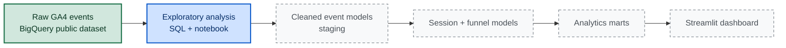

# GrowthScope

**Marketing & Growth Intelligence for E-commerce**


-FF4B4B?logo=streamlit&logoColor=white)
-3F4F75?logo=plotly&logoColor=white)


> **GrowthScope turns raw GA4 event data from an e-commerce store into decisions**: where customers drop off, which acquisition channels bring valuable visitors, where revenue leaks — and which fixes are worth testing first.

> 🚧 **Status: Sprint 01 — Project Foundation & Data Discovery.** The repository now contains the project foundation (`requirements.txt`, `pyproject.toml`, `.env.example`), cost-guarded **SQL exploration queries** in `sql/exploration/`, the **exploratory notebook** `notebooks/01_data_discovery.ipynb`, a **data-quality audit** framework with a **pytest suite**, and the documentation set: [architecture](docs/architecture.md), [dataset research](docs/dataset_research.md), [data dictionary](docs/data_dictionary.md), [metric dictionary](docs/metric_dictionary.md), [data quality audit](docs/data_quality_audit.md), and the [Sprint 01 report](docs/sprint_01_report.md). The dashboard, funnel marts and CI are on the [roadmap](#roadmap).

> [!IMPORTANT]
> **Honest environment note.** Live BigQuery execution could **not** be performed in the build environment (no credentials — `gcloud`/`bq` unavailable, API access returns HTTP 401). The SQL queries and the notebook are ready, cost-guarded and documented, and the [exact steps to obtain verified results](#how-to-reproduce-the-analysis) are provided below. **No number in this repository is presented as a live query result**, and every metric is tagged `PROPOSED` / `BLOCKED (NO BIGQUERY ACCESS)` until it is run against the real dataset. See [Sprint 01 status](#sprint-01-status).

## Contents

- [The business problem](#the-business-problem)
- [What GrowthScope delivers](#what-growthscope-delivers)
- [Conversion funnel: the analytical core](#conversion-funnel-the-analytical-core)
- [Growth Opportunity Engine](#growth-opportunity-engine)
- [Architecture](#architecture)
- [Data source](#data-source)
- [Metrics](#metrics)
- [Tech stack](#tech-stack)
- [Repository structure](#repository-structure)
- [Getting started](#getting-started)
- [How to reproduce the analysis](#how-to-reproduce-the-analysis)
- [Data quality and testing](#data-quality-and-testing)
- [Sprint 01 status](#sprint-01-status)
- [Documentation index](#documentation-index)
- [Roadmap](#roadmap)
- [Limitations and honest analytics](#limitations-and-honest-analytics)
- [License](#license)

## The business problem

An online store gets thousands of visitors, yet the business cannot answer basic growth questions from raw analytics exports:

- Why do most visitors never buy — and at which exact step do they leave?
- Which acquisition channels bring users who actually convert, not just traffic?
- How much potential revenue is lost at each funnel step, and where is the biggest addressable drop-off?
- Which customer segments come back — and which never return?

Answering these questions requires event-level data processing: reconstructing sessions, ordering funnel steps in time, and modeling metrics with transparent, testable formulas. That is what GrowthScope does.

## What GrowthScope delivers

Seven product modules (target: v1.0 — only the analytical foundation exists today):

| # | Module | What it answers |
|---|--------|-----------------|
| 01 | **Executive Overview** | Revenue, orders, users, sessions, purchase conversion, AOV, daily dynamics. Filters by period, device, segment |
| 02 | **Conversion Funnel** | How many sessions reach each purchase step, where the largest drop-off happens, differences by device and channel |
| 03 | **Acquisition Intelligence** | Where users come from: audience size, conversion and revenue by source (within GA4 attribution limits) |
| 04 | **Customer Behavior & Retention** | New vs returning users, repeat purchases, cohorts, time from first visit to purchase |
| 05 | **Revenue & Product Analytics** | Top products and categories, revenue, AOV, basket size, products viewed often but rarely bought |
| 06 | **Growth Opportunity Engine** | Data-derived hypotheses: problem segments, scenario-based revenue potential, what to verify next |
| 07 | **Data Quality Monitor** | Missing values, incomplete sessions, suspicious duplicates, event coverage, test status |

## Conversion funnel: the analytical core

The e-commerce funnel:

```text
session → view_item → add_to_cart → begin_checkout → purchase
```

Two levels of rigor, built in sequence:

1. **Event-presence funnel** — the share of sessions where each step occurred at least once.
2. **Ordered funnel** — a step counts only if it happened *after* the previous step within the same session (window functions over event timestamps).

Engineering challenges handled in SQL:

- **Session reconstruction** — `ga_session_id` is unique only within a user (it is generated as the session-start timestamp in seconds), so the session key is `(user_pseudo_id, ga_session_id)`.
- **Repeated events** — multiple `view_item` / `add_to_cart` count once per session, with order preserved.
- **Incomplete sessions** — sessions with missing identifiers are excluded from funnel math *and their share is measured*, not hidden.
- **Segment comparison** — drop-off by device, channel, product category, new vs returning users, time.

The funnel feeds a **revenue opportunity simulator**: e.g. 10,000 sessions, $40 AOV, purchase conversion 2.0% → 2.5% implies +50 orders and +$2,000 expected revenue at constant traffic and AOV. This is a mathematical scenario, **not a causal forecast** — always labeled as such in the product.

## Growth Opportunity Engine

Not a generic "advice generator" — every hypothesis is computed from data and structured for verification:

| Part | Example (illustrative) |
|---|---|
| **Observation** | Mobile step conversion `view_item → add_to_cart` is below desktop |
| **Evidence** | Measured gap in percentage points, affected sessions, estimated revenue at stake |
| **Possible causes** | UX friction on mobile product page, delivery options, audience/product mix |
| **What to check** | Mobile product page audit; A/B test against a measured baseline |
| **Potential effect** | Scenario range, clearly marked as an estimate to validate, not a promise |

## Architecture



**Legend:** solid green = external source available today · solid blue = implemented in Sprint 01 (artifacts authored; live execution blocked) · dashed grey = planned. The full rationale (including the cost model and the session-key decision) is in [docs/architecture.md](docs/architecture.md).

Layered data models (dbt management comes post-MVP):

| Layer | Model | Grain / contents | Status |
|---|---|---|---|
| Staging | `stg_ga4_events` | One row per event; nested GA4 params flattened to typed columns | Planned (Sprint 02) |
| Intermediate | `int_sessions` | One row per session `(user_pseudo_id, ga_session_id)` | Planned (Sprint 02) |
| Intermediate | `int_session_funnel` | Funnel flags and step ordering per session | Planned (Sprint 03) |
| Fact | `fct_purchases` | One row per transaction (de-duplicated on `transaction_id`) | Planned (Sprint 04) |
| Mart | `mart_daily_kpis` | Daily revenue, users, sessions, conversion, AOV | Planned (Sprint 04) |
| Mart | `mart_acquisition` | Metrics by traffic source | Planned (Sprint 04) |
| Mart | `mart_products` | Product and category performance | Planned (Sprint 04) |
| Mart | `mart_cohorts` | Cohorts, retention, repeat purchases | Planned (Sprint 06) |

## Data source

**GA4 obfuscated sample e-commerce dataset** (Google Merchandise Store) — public BigQuery dataset `bigquery-public-data.ga4_obfuscated_sample_ecommerce`.

| | |
|---|---|
| Period | 2020-11-01 → 2021-01-31 (three months) — [Google's documentation](https://developers.google.com/analytics/bigquery/web-ecommerce-demo-dataset) |
| Format | GA4 event export, nested BigQuery schema ([schema reference](https://support.google.com/analytics/answer/7029846)) |
| Implementation | Standard web e-commerce implementation + enhanced measurement (per Google) |
| Access | [BigQuery Sandbox](https://cloud.google.com/bigquery/docs/sandbox) — free, no credit card required |

Google warns that the dataset is *obfuscated and partially adjusted*: certain fields contain placeholder values (`<Other>`, `NULL`, `''`) and "internal consistency of the dataset might be somewhat limited". GrowthScope treats this as part of the job: **data audit first, metrics second.** Full profile: [docs/dataset_research.md](docs/dataset_research.md).

Honest constraints:

- No advertising-spend table exists in the dataset → **CAC, ROAS and ad profit are out of scope**; nothing is fabricated to fill the gap.
- `traffic_source` fields describe **first-user acquisition**, not per-session attribution — the two are never mixed.
- Raw user events are never committed to this repository; only small synthetic fixtures or aggregated demo data are published.

## Metrics

Core metrics with full formulas, grains and failure modes: [docs/metric_dictionary.md](docs/metric_dictionary.md). Every metric carries an explicit validation status; after Sprint 01 all of them are `PROPOSED` / `BLOCKED (NO BIGQUERY ACCESS)` — no business metric is claimed as verified yet.

| Metric | Definition | Level |
|---|---|---|
| Sessions | Unique `(user_pseudo_id, ga_session_id)` | Session |
| Observed Users | Unique `user_pseudo_id` | User |
| Session Purchase Conversion Rate | Sessions with a purchase ÷ all sessions | Session (a separate user-level rate is computed independently — the two differ) |
| Funnel Step Conversion Rate | Sessions reaching step N+1 ÷ sessions reaching step N | Session |
| Drop-off Rate | 1 − step conversion rate | Session |
| Revenue | Sum of `purchase_revenue_in_usd` over de-duplicated purchase events | Order |
| Average Order Value | Revenue / number of unique orders | Order |
| Revenue per Session | Revenue / number of sessions | Session |
| Repeat Purchase Rate | Buyers with more than one purchase / all buyers | User |
| Time to Purchase | Purchase timestamp − chosen start point | User, session |

> [!WARNING]
> The dataset has no ad-spend data. **CAC and ROAS cannot be computed** — GrowthScope will never display them.

## Tech stack

| Technology | Purpose | Priority |
|---|---|---|
| Python | Data processing, analytics logic | Core |
| SQL / BigQuery | Event queries, aggregations, window functions | Core |
| Pandas | Exploratory analysis, quality checks | Core |
| Streamlit | Web application | Core — planned |
| Plotly | Interactive charts | Core — planned |
| Git / GitHub | Version control, portfolio | Core |
| pytest | Automated testing | Core |
| dbt | SQL model and test management | Post-MVP |
| GitHub Actions | CI and automated checks | Post-MVP |
| PySpark | Large-volume experiments | Advanced track |

## Repository structure

Current state after Sprint 01:

```text
growthscope/
├── sql/
│   └── exploration/            # Sprint 01 discovery queries (cost-guarded, read-only)
├── notebooks/
│   └── 01_data_discovery.ipynb # Sprint 01 exploratory notebook (authored; not yet executed live)
├── src/
│   └── growthscope/
│       └── quality/            # Data-quality checks on GA4 aggregates (pandas/numpy)
├── tests/                      # pytest suite: quality checks + static SQL validation (synthetic data)
│   └── fixtures/               # synthetic fixtures only — never raw user-level data
├── docs/                       # architecture, dataset research, dictionaries, audit, sprint report
├── data/                       # local sample/aggregated data only; raw exports are gitignored
├── requirements.txt
├── pyproject.toml              # packaging metadata + pytest config (src layout)
├── .env.example                # safe, secret-free configuration template
├── README.md
└── LICENSE                     # MIT
```

**Planned, not present yet** — do not look for these in the current tree:

```text
app/                            # Streamlit application (Sprint 05)
dbt/                            # dbt models and tests (post-MVP)
.github/workflows/              # CI pipeline (Sprint 07)
```

## Getting started

**Prerequisites:** Python 3.11+ (developed on 3.12). For live BigQuery queries later: a Google Cloud project with the BigQuery API enabled (Sandbox tier is free).

```bash
git clone https://github.com/nnurkass/growthscope.git
cd growthscope
python -m venv .venv
```

**Windows (PowerShell)**

```powershell
.\.venv\Scripts\Activate.ps1      # or .venv\Scripts\activate.bat in cmd.exe
python -m pip install --upgrade pip
pip install -r requirements.txt
Copy-Item .env.example .env       # adjust values; never commit .env
```

> If PowerShell blocks script execution, either run `.venv\Scripts\activate.bat` in `cmd.exe` or allow scripts for the current session only: `Set-ExecutionPolicy -Scope Process -ExecutionPolicy Bypass`.

**macOS / Linux**

```bash
source .venv/bin/activate
python -m pip install --upgrade pip
pip install -r requirements.txt
cp .env.example .env              # adjust values; never commit .env
```

Run the test suite (no BigQuery access and no editable install required — `pyproject.toml` puts `src/` on the pytest path):

```powershell
.venv\Scripts\python.exe -m pytest          # Windows
python -m pytest                            # macOS / Linux (venv active)
```

Credentials are never committed. For live queries, prefer Application Default Credentials:

```bash
gcloud auth application-default login
```

> 🚧 The Streamlit dashboard (`app/`) and SQL models do not exist yet — see the [roadmap](#roadmap). Nothing here claims a running app.

## How to reproduce the analysis

The repository is set up so any reviewer with a free Google Cloud project can reproduce the intended Sprint 01 analysis and obtain the first *live-verified* numbers.

**1 · Get BigQuery access.** Create a Google Cloud project and enable the BigQuery API — the [BigQuery Sandbox](https://cloud.google.com/bigquery/docs/sandbox) is free and requires no credit card. (The public dataset is readable by any project; only the querying is billed — to the sandbox's free monthly quota.)

**2 · Configure the environment.** Copy `.env.example` to `.env` and set `GOOGLE_CLOUD_PROJECT` to your project. Authenticate with `gcloud auth application-default login` (or point `GOOGLE_APPLICATION_CREDENTIALS` at a key file — discouraged).

**3 · Run the exploration queries** — `sql/exploration/*.sql`, each with a documented Purpose and Caveats header. Start with the dry run, then the real run:

```bash
# macOS / Linux — dry run first: reports bytes that WOULD be scanned, charges nothing
bq query --use_legacy_sql=false --dry_run "$(cat sql/exploration/<file>.sql)"
# then the real run, with the cost guard
bq query --use_legacy_sql=false --maximum_bytes_billed=2000000000 "$(cat sql/exploration/<file>.sql)"
```

```powershell
# Windows PowerShell — same two steps
bq query --use_legacy_sql=false --dry_run "$(Get-Content sql/exploration/<file>.sql -Raw)"
bq query --use_legacy_sql=false --maximum_bytes_billed=2000000000 "$(Get-Content sql/exploration/<file>.sql -Raw)"
```

Equivalently: paste a query into the BigQuery console editor, check the validator's byte estimate, then run. Usage notes live in [sql/exploration/README.md](sql/exploration/README.md).

**4 · Run the notebook.** With the virtual environment active:

```bash
jupyter lab
```

Then open `notebooks/01_data_discovery.ipynb` and run the cells top to bottom (they read configuration from `.env` and apply the byte cap).

**Cost-safety rules used throughout this repository**

| Rule | Where |
|---|---|
| Small default window: `2020-11-01 → 2020-11-03` (3 days of 92), configurable via `GA4_START_DATE` / `GA4_END_DATE` | `.env.example`, notebook |
| Every wildcard query restricts `_TABLE_SUFFIX` (e.g. `BETWEEN '20201101' AND '20201103'`) | `sql/exploration/*.sql`, enforced by tests |
| Dry run / console estimate before every real query | this section |
| Hard per-query cap `maximum_bytes_billed` (≈ 2 GB default via `BQ_MAX_BYTES_BILLED`) — over-budget queries fail instead of billing | `.env.example`, notebook, CLI examples above |
| No `SELECT *` on the nested export; aggregates before raw rows | enforced by tests |

## Data quality and testing

Sprint 01 ships an offline-capable quality library (`src/growthscope/quality/`) and a pytest suite (`tests/`) that runs **without any cloud access**, against synthetic fixtures.

| Check family | Catches | Status |
|---|---|---|
| Missing identifiers | rows without `user_pseudo_id` / `ga_session_id` (excluded from session math, then reported) | Implemented (local) |
| Duplicate composite keys | broken grain / fan-out in session-level aggregates | Implemented (local) |
| Session-id reuse across users | proves why `ga_session_id` alone is not a key | Implemented (local) |
| Purchase transaction duplicates | double-counted orders and revenue | Implemented (local) |
| Revenue NULL rate / currency consistency | local-currency revenue that cannot be summed | Implemented (local) |
| Timestamp validity | seconds/milliseconds mistaken for microseconds; impossible dates | Implemented (local) |
| Date coverage | missing days in an export window | Implemented (local) |
| Funnel monotonicity | step counts that grow — impossible in a correct funnel | Implemented (local) |
| Static SQL safety | write statements, bare `SELECT *`, wildcard scans without `_TABLE_SUFFIX` | Implemented (local) |
| Live reconciliation (events vs marts) | metric drift between layers | Planned (Sprint 03–04) |

Fixtures are synthetic by policy ([tests/fixtures/README.md](tests/fixtures/README.md)); a check passing locally proves the *logic*, never a fact about the dataset.

## Sprint 01 status

Status vocabulary: **Done** — exists and is locally validated · **Blocked-live-execution** — artifact exists and is documented, but execution against BigQuery was impossible in the build environment (no credentials) · **Planned** — future sprint.

| Deliverable | Status |
|---|---|
| Repository foundation (README, MIT license, `.gitignore`, `requirements.txt`, `pyproject.toml`, `.env.example`) | Done |
| SQL exploration queries (`sql/exploration/`, cost-guarded, statically validated) | Blocked-live-execution |
| Exploratory notebook (`notebooks/01_data_discovery.ipynb`) | Blocked-live-execution |
| Data-quality audit framework + pytest suite (`src/growthscope/quality/`, `tests/`) | Done (local, synthetic data) |
| Dataset research ([docs/dataset_research.md](docs/dataset_research.md)) | Done (from official documentation) |
| Data dictionary ([docs/data_dictionary.md](docs/data_dictionary.md)) | Done (structure documented; live fields marked unverified) |
| Metric dictionary ([docs/metric_dictionary.md](docs/metric_dictionary.md)) | Done (definitions); live validation Blocked-live-execution |
| Architecture document ([docs/architecture.md](docs/architecture.md)) | Done |
| Live BigQuery results (any number from the real dataset) | Blocked-live-execution |
| Streamlit dashboard | Planned (Sprint 05) |

## Documentation index

| Document | Contents |
|---|---|
| [docs/architecture.md](docs/architecture.md) | Data layers, why BigQuery, cost model, modeling decisions, out-of-scope list |
| [docs/dataset_research.md](docs/dataset_research.md) | Dataset profile: origin, period, obfuscation, access model |
| [docs/data_dictionary.md](docs/data_dictionary.md) | Field-level reference, `event_params` keys, currency and timestamp callouts |
| [docs/metric_dictionary.md](docs/metric_dictionary.md) | Metric formulas, grains, failure modes, validation statuses, metric traps |
| [docs/data_quality_audit.md](docs/data_quality_audit.md) | Data-quality audit: what is checked, what is pending live verification |
| [docs/sprint_01_report.md](docs/sprint_01_report.md) | Sprint 01 delivery report: done, tested, blocked |
| [sql/exploration/README.md](sql/exploration/README.md) | How to run the exploration queries and read their output |

## Roadmap

| Phase | Focus | Outcome | Status |
|---|---|---|---|
| 01 Foundation & Discovery | Repo, environment, BigQuery setup, dataset audit | Exploration SQL, notebook, quality framework, dictionaries | ✅ Artifacts delivered — live verification pending |
| 02 Cleaning & Sessions | Parameter extraction, normalization, session rules | `stg_ga4_events`, `int_sessions` + first live-verified metrics | Next |
| 03 Funnel Analytics | Presence funnel → ordered funnel, drop-off analysis | Verified funnel metrics + SQL tests | Planned |
| 04 Metrics & Marts | Revenue, products, acquisition, daily KPIs | Dashboard-ready marts | Planned |
| 05 Streamlit Dashboard | Overview, Funnel, Acquisition with filters | First app version | Planned |
| 06 Advanced Analytics | Cohorts, segmentation, Growth Opportunity Engine | At least 3 evidence-based business hypotheses | Planned |
| 07 Testing, CI & Deployment | pytest suites, GitHub Actions, public demo | Reproducible project with CI and public link | Planned |
| 08 Portfolio Release | Query optimization, demo video, docs, case study | GrowthScope v1.0 | Planned |

**v1.0 release checklist**

- [x] Data can be obtained via documented instructions
- [ ] Core KPIs and the ordered funnel are computed *and live-verified*
- [ ] No known double-counting of sessions or revenue
- [ ] At least four working analytical screens
- [x] Automated tests written (local / synthetic)
- [ ] Dashboard publicly deployed
- [x] README, architecture and data limitations documented
- [ ] At least three verifiable business insights

## Limitations and honest analytics

- **The dataset is obfuscated and adjusted by Google**; some values are placeholders and internal consistency is limited ([source](https://developers.google.com/analytics/bigquery/web-ecommerce-demo-dataset)). Every metric ships with a reliability note.
- **Live execution was impossible in the Sprint 01 build environment** — no BigQuery credentials. Consequently, every metric and field-level claim is marked `PROPOSED` / `[UNVERIFIED — needs BigQuery]`; the reproduction steps above close that gap.
- **No ad-spend data → no CAC/ROAS claims**; acquisition analysis describes behavior, not profitability.
- **Observation window (Nov 2020 – Jan 2021)** limits seasonality and long-term retention conclusions; retention metrics are especially sensitive to window length.
- **GA UI numbers and BigQuery numbers differ** (reports use estimation; BigQuery counts are precise). GrowthScope documents its counting rules instead of silently reconciling to a UI.
- A low step conversion rate alone proves nothing — it defines *what to investigate*, not the cause.
- Scope discipline: analytics and data engineering first; ML/LLM explanations only if the data layer is stable.

## License

MIT — see [LICENSE](LICENSE).

---

*Independent portfolio project. Not affiliated with, endorsed by, or sponsored by Google. GA4 sample data is used under the terms of its public dataset.*
