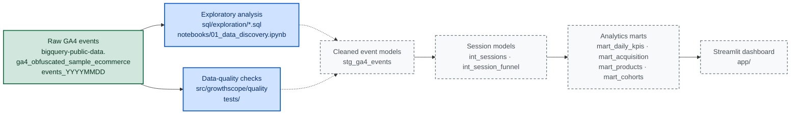

# GrowthScope — Architecture

This document describes how data flows through GrowthScope, which layers exist **today** and which are **planned**, and the reasoning behind the core modeling decisions. It is written to be read by a reviewer: claims about the dataset are either referenced to official Google documentation or explicitly marked as unverified.

> [!IMPORTANT]
> **Execution status in Sprint 01.** No live BigQuery query was executed in the build environment (no credentials, sandbox untouched). All SQL in `sql/exploration/` and the notebook `notebooks/01_data_discovery.ipynb` are authored, cost-guarded and documented, but their output is **not yet verified against the real dataset**. Wherever this document says "implemented", it means *artifacts exist in the repository*, not *results were observed*. See [How to reproduce the analysis](../README.md#how-to-reproduce-the-analysis) in the README.

## Contents

- [Layered progression](#layered-progression)
- [Layer reference](#layer-reference)
- [Why BigQuery](#why-bigquery)
- [Cost model and guardrails](#cost-model-and-guardrails)
- [Modeling decisions and why](#modeling-decisions-and-why)
- [Explicitly out of scope for Sprint 01](#explicitly-out-of-scope-for-sprint-01)
- [Non-functional requirements](#non-functional-requirements)

## Layered progression

```
Raw GA4 Events
  → Exploratory Analysis        (Sprint 01 — implemented)
  → Cleaned Event Models        (planned — Sprint 02)
  → Session Models              (planned — Sprint 02/03)
  → Analytics Marts             (planned — Sprint 04)
  → Streamlit Dashboard         (planned — Sprint 05)
```

Each layer has a single clearly stated grain, and each layer is derivable from the one above it. Nothing jumps layers: the dashboard will never query raw events directly.



**Legend**

| Style | Meaning |
|---|---|
| Solid green | External source of truth, available today (Google public dataset) |
| Solid blue | Implemented in Sprint 01 — artifacts exist; live execution is blocked in the build environment (see note above) |
| Dashed grey | Planned, not present in the repository |

## Layer reference

| # | Layer | Purpose | Grain | Key columns | Sprint | Status |
|---|---|---|---|---|---|---|
| 0 | Raw GA4 events | Immutable source of truth for all event-level analysis | One row per event (repeated `event_params`/`items` expand to nested arrays, not extra rows in BigQuery) | `event_date`, `event_timestamp`, `event_name`, `user_pseudo_id`, `event_params`, `items`, `ecommerce`, `traffic_source`, `collected_traffic_source` | 01 | Available (public dataset) |
| 1 | Exploratory analysis | Schema reconnaissance, event-parameter inventory, date coverage, event counts, funnel sanity checks, cost estimation | Ad-hoc query results and notebook aggregates | Counts, distincts, observed keys | 01 | Implemented (authored; not executed live) |
| 1b | Data-quality checks | Reusable pandas checks on local synthetic fixtures: required keys, null rates, funnel monotonicity invariants | Fixture datasets (`data/`) | `user_pseudo_id`, `ga_session_id`, `event_name`, step order | 01 | Implemented (local, synthetic data only) |
| 2 | Cleaned event models | One row per event with `event_params` unpacked into typed columns; naming and typing normalized | One row per event | `event_date`, `event_timestamp`, `user_pseudo_id`, `ga_session_id`, `ga_session_number`, `page_location`, `source`, `medium`, `campaign`, `transaction_id` | 02 | Planned (`stg_ga4_events`) |
| 3 | Session models | Reconstruct sessions and order funnel steps inside them | One row per `(user_pseudo_id, ga_session_id)` | Session start/end, entry page, device, channel, `view_item`/`add_to_cart`/`begin_checkout`/`purchase` flags and timestamps | 02–03 | Planned (`int_sessions`, `int_session_funnel`) |
| 4 | Analytics marts | Dashboard-ready aggregates with stable column names and documented metric semantics | Day / session / user / order / product | Revenue, orders, sessions, users, conversion rates, AOV | 04 | Planned (`mart_*`) |
| 5 | Streamlit dashboard | Interactive presentation of marts and the Growth Opportunity Engine | n/a | n/a | 05+ | Planned (`app/`) |

Column-level details (types, modes, semantics, caveats) live in [`data_dictionary.md`](data_dictionary.md); metric formulas live in [`metric_dictionary.md`](metric_dictionary.md).

## Why BigQuery

The workload is event-level web analytics: nested GA4 events (repeated parameters, item arrays), grouped by session, user, day, device, and channel. BigQuery is the right engine for it for concrete reasons:

1. **Columnar storage.** Aggregations scan only referenced columns. GA4 event tables are wide and nested; column pruning is what keeps an exploration query cheap and fast.
2. **Native nested/repeated fields.** `event_params` and `items` are repeated RECORDs ([documented](https://support.google.com/analytics/answer/7029846)). BigQuery stores and unnests them without pre-flattening the source data, so exploration can start before any ETL is written.
3. **Serverless execution.** No cluster to size or operate. The Sprint 01 workload fits the free tier; larger analyses scale automatically.
4. **Partition-friendly layout.** The export already lands as one table per day (`events_YYYYMMDD`), so restricting `_TABLE_SUFFIX` restricts the bytes scanned. Our own models (Sprint 02+) can be partitioned/clustered on `event_date` for the same reason.
5. **Pay-per-bytes-scanned cost model.** Cost is a direct consequence of query hygiene, which makes it a first-class engineering concern rather than an afterthought (see guardrails below).
6. **Public dataset access.** `bigquery-public-data.ga4_obfuscated_sample_ecommerce` needs no ingestion pipeline: a reviewer can reproduce the analysis with a free project.
7. **Production realism.** GA4 exports to BigQuery natively. A pipeline built against the sample export maps directly onto how real GA4 properties are analyzed, so the SQL generalizes beyond this exercise.

### Cost model and guardrails

BigQuery bills on bytes **scanned** per query (the free tier currently includes 1 TB of querying per month; the [BigQuery Sandbox](https://cloud.google.com/bigquery/docs/sandbox) requires no credit card, with documented limits). A careless `SELECT *` on a year of event data can scan many gigabytes for a trivial answer.

Rules used in this repository:

| Guardrail | Implementation |
|---|---|
| Query only a small window | Default exploration window is `2020-11-01 → 2020-11-03` (`GA4_START_DATE` / `GA4_END_DATE`) |
| Prune daily tables | Every wildcard query filters `_TABLE_SUFFIX` (e.g. `BETWEEN '20201101' AND '20201103'`) |
| Hard per-query byte limit | `maximum_bytes_billed` set from `BQ_MAX_BYTES_BILLED` (default ≈ 2 GB); queries over budget fail instead of billing |
| Dry run before real run | `bq query --dry_run` (or the console validator) reports bytes to be scanned without charging |
| No `SELECT *` on nested tables | Queries select only the columns they need |
| Prefer aggregated output | Exploration queries return counts and distributions, not raw user-level rows |

> [!NOTE]
> These are deterministic query-hygiene rules, not estimates. The *actual* bytes scanned cannot be claimed until queries are executed with real credentials; the dry-run output is the ground truth and is recorded when the queries are first run.

## Modeling decisions and why

These decisions are fixed at the definition level: Sprint 01 encodes them in the SQL queries and in the local quality checks; the actual computations run in Sprint 02+ once the models are built.

### 1. The session key is `(user_pseudo_id, ga_session_id)`

`ga_session_id` is generated as the **timestamp in seconds when the session started** ([documented](https://support.google.com/analytics/answer/9191807)). It is therefore only unique *within a user*, not globally — two users who start sessions in the same second share the same `ga_session_id`. Google's own guidance is explicit: join `user_id`/`user_pseudo_id` with the session ID to obtain a session identifier outside of Analytics.

Consequences we accept and document:

- The session grain is **always** the composite key. No query may group by `ga_session_id` alone.
- Sessions can span midnight; a session that starts before the queried date window technically continues the previous day. Sprint 02 will include a boundary-day buffer (or exclude boundary sessions and *measure* their share) rather than silently counting them incorrectly.

### 2. `event_params` is unpacked at staging time, not in every query

`event_params` is a repeated key/value RECORD. Any query that needs `ga_session_id`, `page_location`, or campaign parameters must `UNNEST` it. Unpacking it once in the staging layer (`stg_ga4_events`, Sprint 02):

- gives every downstream query typed columns (`ga_session_id` as an integer, not a string buried in a record);
- keeps session, funnel, and mart SQL readable and reviewable;
- avoids repeating the same `UNNEST` boilerplate (and the same subtle bugs) in dozens of queries.

Trade-off: the staging model must be extended when a new parameter is needed. That is a deliberate, small cost — and the raw table remains the fallback for ad-hoc exploration.

### 3. The ordered funnel needs window functions over `event_timestamp`

A presence-based funnel ("did this session contain a `purchase` event?") answers *whether*, not *when*. Ordering matters: a session that views an item *after* purchasing must not be counted as a funnel success. The ordered funnel therefore:

- partitions by `(user_pseudo_id, ga_session_id)`;
- orders by `event_timestamp` (microseconds, UTC);
- compares the first occurrence of each step against the previous step's first occurrence.

One documented subtlety: multiple events can share the same `event_timestamp` (events sent in one request). The tie-breaking policy (`batch_event_index` / `batch_ordering_id`, and whether equal timestamps count as "reached") is fixed in SQL comments in Sprint 03 — not left to chance per query.

### 4. Purchases are de-duplicated on `transaction_id` before revenue math

A purchase can reach BigQuery more than once: client-side and server-side tagging for the same transaction, reloads of the confirmation page, or measurement bugs. Counting raw `purchase` events would inflate both orders and revenue. The rule:

- orders are counted as **distinct `ecommerce.transaction_id` per user**;
- events without a `transaction_id` cannot be de-duplicated — they are excluded from order/revenue math and their count is surfaced in the data-quality output instead of being hidden.

### 5. `purchase_revenue_in_usd` is preferred over `purchase_revenue`

The schema defines `purchase_revenue` as "local currency" and `purchase_revenue_in_usd` as "USD with standard unit" ([documented](https://support.google.com/analytics/answer/7029846)). They are **two fields with two units**, so summing `purchase_revenue` across a multi-currency window adds unlike quantities. GrowthScope therefore uses the USD-normalized fields (`purchase_revenue_in_usd`, `price_in_usd`, `item_revenue_in_usd`) for all revenue math and records this as a standing rule. See the callout in [`data_dictionary.md`](data_dictionary.md#currency-safety).

A separate and weaker claim — that `purchase_revenue` is populated *only* when the event currency matches the property currency — is deliberately **not** relied upon: the documentation review recorded it as `[UNRESOLVED]` (`dataset_research.md` §10.2). The design does not need it, which is precisely why the USD-normalized field is the safer basis.

## Explicitly out of scope for Sprint 01

The following are deliberately **not** built in this sprint. Naming them prevents silent scope creep:

- Streamlit application (`app/`)
- Any production dashboard
- Full funnel data marts (`fct_*`, `mart_*`)
- Machine learning / LLM components
- PySpark or distributed processing
- Paid infrastructure of any kind (beyond the free BigQuery tiers)
- Authentication / user accounts
- Microservices
- Docker / Kubernetes

Sprint 01 delivers: repository foundation, cost-guarded exploration SQL, one documented exploratory notebook, a data-quality check module with pytest coverage on synthetic fixtures, the documentation set (dataset research, data dictionary, metric dictionary, data-quality audit, sprint report), and this architecture document.

## Non-functional requirements

| Requirement | How it is met |
|---|---|
| **Reproducibility** | Lower-bound dependencies in `requirements.txt`; environment documented in `.env.example`; SQL files and the notebook contain the exact steps; pytest runs without an editable install (`pythonpath` in `pyproject.toml`) |
| **Cost safety** | Small default date window, `_TABLE_SUFFIX` pruning, `maximum_bytes_billed` guard, dry runs before real runs (see guardrails above) |
| **No secrets in git** | `.env` is gitignored; `.env.example` contains placeholders only; ADC preferred over service-account keys |
| **Cross-platform (Windows / macOS)** | Both PowerShell and POSIX commands are documented; no hardcoded user paths; `python -m ...` entry points |
| **No raw user-level data committed** | `data/` holds only synthetic fixtures or small aggregates; raw exports are never copied into the repository |
| **Honest labeling** | Everything authored-but-not-executed is labeled as such in README, this document, and the dictionaries |

## References

- BigQuery Export schema — <https://support.google.com/analytics/answer/7029846>
- GA4 e-commerce sample dataset — <https://developers.google.com/analytics/bigquery/web-ecommerce-demo-dataset>
- About Analytics sessions (`ga_session_id` semantics, 30-min timeout) — <https://support.google.com/analytics/answer/9191807>
- Automatically collected events (`session_start`, page parameters) — <https://support.google.com/analytics/answer/9234069>
- Recommended events (e-commerce event names) — <https://support.google.com/analytics/answer/9267735>
- BigQuery Sandbox — <https://cloud.google.com/bigquery/docs/sandbox>
